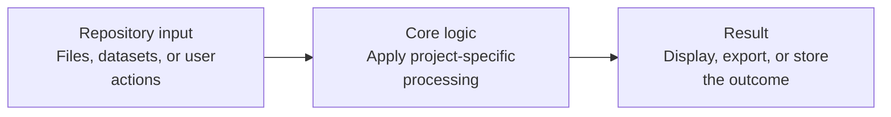

# Git Practice

**Learning archive** · A practical Git exercise repository demonstrating everyday version-control workflows.

## Overview

A practical Git exercise repository demonstrating everyday version-control workflows.

## Technology Stack

- `HTML`
- `Python`

## How the Repository Works

| Stage | Responsibility |
|---|---|
| **Repository input** | Files, datasets, or user actions |
| **Core logic** | Apply project-specific processing |
| **Result** | Display, export, or store the outcome |

## Concepts Covered

- Git initialization and staging
- Branching and merging
- Remotes and synchronization
- Conflict resolution
- Repository history

## Repository Map

- `.gitignore`
- `a1`
- `a2`
- `a3`
- `b1.txt`
- `b2.txt`
- `c1.txt`
- `check.txt`
- `f1.txt`
- `hy.py`
- `index.html`
- `localfile.txt`

## Recruiter Summary

This repository shows hands-on practice, iterative learning, and problem-solving across the technologies listed above. It is most useful as evidence of foundational growth and experimentation rather than as a production release.

---

Documentation is concise and project-focused; source code was not modified.
